<p align="center">
  
</p>

<h1 align="center">endurancr</h1>

<p align="center">
  Run for you. Not for the feed.<br>
  A private, adaptive running plan for iPhone and Apple Watch.
</p>

<p align="center">
  <a href="https://apps.apple.com/app/endurancr/id6815730653">App Store</a> ·
  <a href="https://endurancr.app">endurancr.app</a> ·
  <a href="https://endurancr.app/privacy">Privacy</a> ·
  <a href="LICENSE">MIT License</a>
</p>

---

endurancr builds a training plan around your goal and the pace you actually like,
records your runs on Apple Watch or iPhone, and adapts the plan to what you really
ran. Paces come from the VDOT method by Jack Tupper Daniels.

- **Local only.** No account, no server, no analytics, no ads. The plan is stored on
  your device, and your runs live in Apple Health.
- **Free.** No subscription and no in-app purchases.
- **Open source.** You can read every line that touches your data.

<p align="center">
  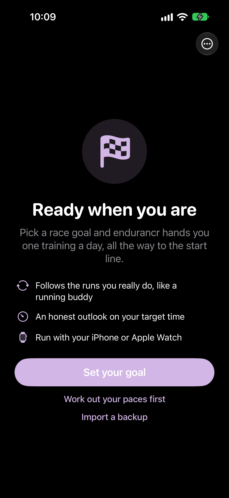
  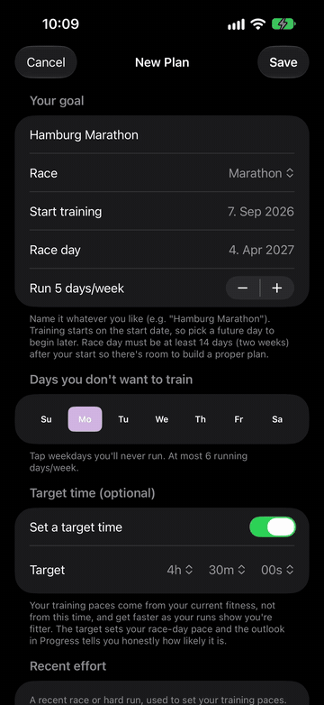
  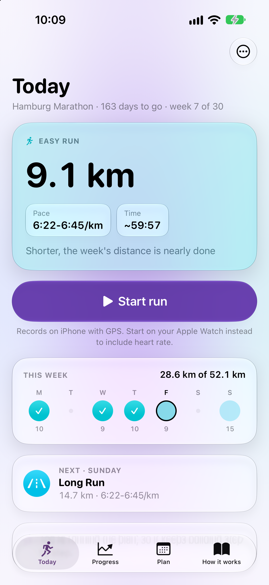
  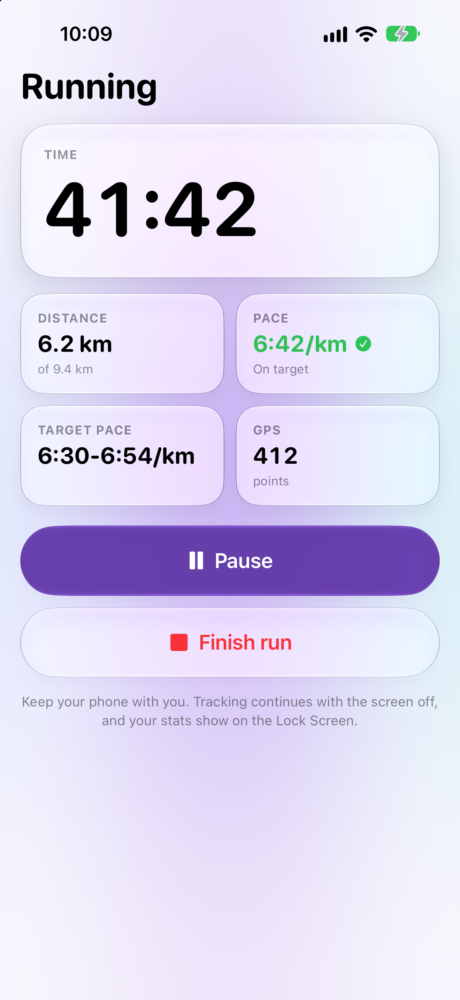
</p>
<p align="center">
  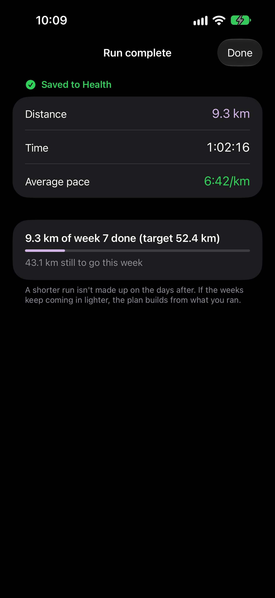
  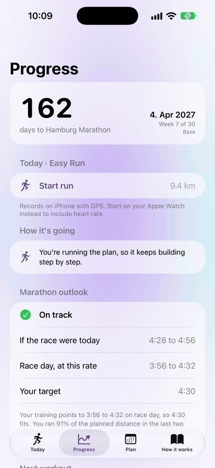
  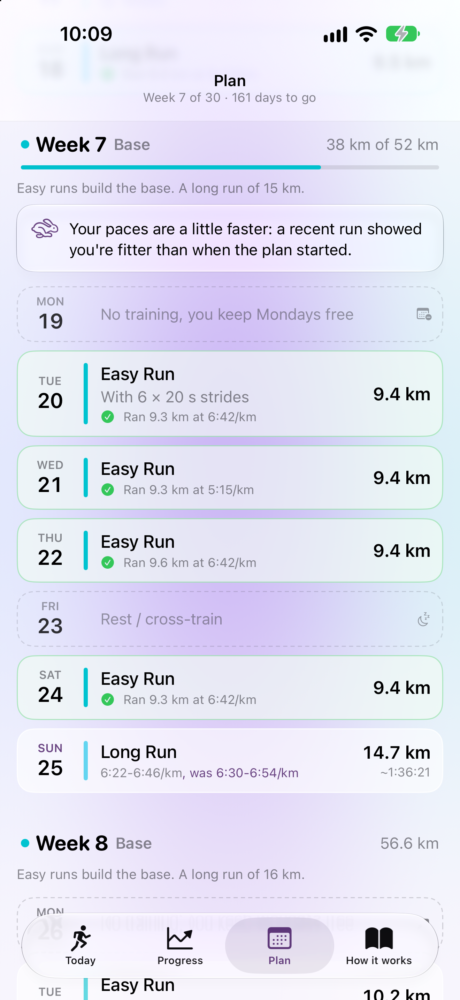
  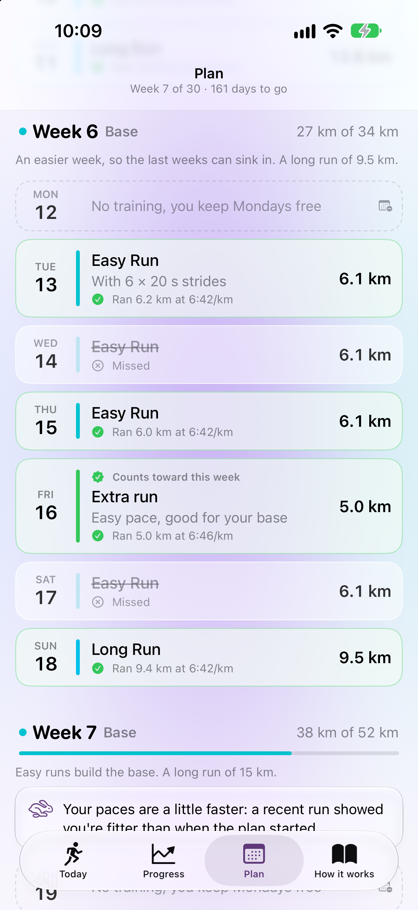
</p>
<p align="center">
  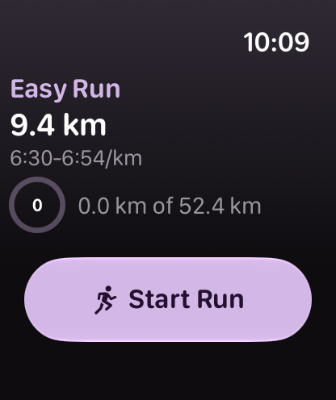
  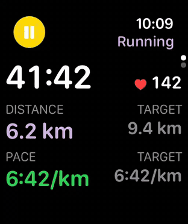
  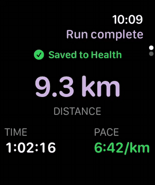
</p>

## Features

- A goal (for example a marathon on a given date) or a target VDOT, and a plan that
  builds towards it week by week.
- The plan adapts like a running buddy who isn't pushy, and never piles missed
  kilometres onto later days:
  - 90% or more of the planned distance over two weeks keeps it building
    (Pfitzinger's benchmark). 75 to 90% holds the week at your last full week. Below that it rebuilds from
    what you ran, at most 10% more a week, and one hard session that week becomes easy.
  - After more than 5 days off, paces ease by Daniels' table and easy-only weeks
    bring you back at a share of your volume before the break.
  - No run is planned more than 10% longer than your longest of the last 30 days
    (Frandsen et al. 2025).
  - VDOT goes up by at most 1 point per 3 weeks, and down 1 when hard sessions
    keep coming in slower than their targets. A session recorded with endurancr is
    judged by its reps (more than half over 5 s/km slower than the target).
- An honest outlook: finish-time ranges for today and race day, and whether the
  target is on track, within reach, a stretch or unlikely, with a realistic time
  to switch to (only if you tap it). Marathon ranges account for weekly distance
  (Vickers & Vertosick 2016).
- Honest marathon pace: when your fitness comes from a much shorter race, marathon
  pace and the finish prediction start up to 3 VDOT lower, and long runs earn it
  back (fully at 25 km for a marathon). Until they do, you get a full build, never
  a "good to go" plan. Easy and interval paces keep your speed.
- Long runs that build to the race: for a marathon, 32 km runs 5 and 3 weeks before race
  day (growing about 2 km a week, never more than half the week), for a half
  marathon 19 km, then shorter long runs in the two taper weeks.
- Runs are spread over the repeating week: a rest day after the Sunday long run when
  there's one to spare, and no threshold or intervals right next to the long run.
- Sessions from the books: marathon-pace runs every other build week and marathon-pace
  finishes on peak long runs (Daniels, Pfitzinger, Hansons, Higdon), strides on easy
  days, a 10 km tune-up race 6 weeks out whose result sets your paces, never more than
  two harder sessions a week, each within Daniels' limits per session.
- Race-day pacing and fuelling (about 60 g of carbohydrate an hour, up to 90 g past
  2½ hours, Jeukendrup 2014), then an easy day for every 3 km raced after it (Daniels).
- Training paces come from your current fitness, never from your target time (Daniels); the target sets race-day pace and the outlook.
- Every run from the start date counts, also on a rest day before the first planned run.
  Recordings under 200 m or a minute don't count, and a run recorded on the watch and
  the iPhone at once counts once.
- Swap days by dragging them in the plan; the watch shows the same adjusted days.
- The plan shows what you ran on each past day (done, shorter or missed), what a changed day was and why, new paces next to the old ones with the reason, what each week is for, how far the week is, the 32 km runs and the taper, and ends with the race outlook.
- Intervals, threshold and marathon-pace blocks, the tune-up race and strides are guided
  on Apple Watch by distance: about 100 m before a rep it taps and shows "Rep 3 of 6 in
  100 m", then "Go" with the rep's distance and pace from your current fitness, and "3 of
  6 done, easy now" after it, each with its own tap. Strides count as about 100 m quick
  and light with about 150 m easy between.
- Start another session: this week's hard session moved to today (swapping the days),
  an interval session of the plan's size in a week with only one, or strides. Only when
  it fits: not in base weeks, not the day after a hard session or the long run, not the
  day before the long run, never two hard days side by side, not in the last 10 days
  before the race, not while easing back or with a raised resting heart rate, and at
  most two hard sessions a week. The list says why when it's not offered.
- A second watch page during the run: average pace, last kilometre, heart rate and
  its average, climb (also saved as the run's elevation gain) and cadence.
- Hold Finish for a second to end a run, on the watch and the iPhone, so it isn't
  ended by accident.
- Once today's run is done, Today and the watch say "Done today" with what was run
  against what was planned, and Start stays for another run.
- Every rep is saved with the run in Apple Health (as segments too), and the plan and
  the run summary show each one against its target: on pace, slower or faster, with
  its pace, in plain words.
- A run on Apple Watch shows on the iPhone's Lock Screen too, through HealthKit workout
  mirroring, with Pause and Finish. Auto-pause comes from watchOS (Auto-Pause in the
  watch's Workout settings), and a double tap pauses or resumes.
- Live run screens on Apple Watch and iPhone, with a Live Activity and controls on
  the Lock Screen.
- A pace calculator: a recent race and a goal give your VDOT, the five paces, a race-day range and the plan it would build. In the app it's on the welcome screen and under Progress, and can start that plan. As an App Clip it opens without installing (endurancr.app/clip), with no HealthKit and nothing stored.
- The plan syncs directly between iPhone and Apple Watch with WatchConnectivity.
- Backup and import of your plan as a file, only when you choose to share it.

## Project layout

```
TrainingCore/       Plain Swift package: VDOT engine, plan generator, adaptation. Runs anywhere.
Shared/             Code shared by both apps: HealthKit, SwiftData store, plan coordinator.
App-iOS/            iPhone app.
App-Clip/           App Clip: the pace calculator (App-iOS/Views/PaceCalculatorView.swift) that opens without installing.
App-iOS-Widgets/    Live Activity extension.
App-watchOS/        Apple Watch app and run recorder.
LiveActivity/       Shared Live Activity attributes and App Intents.
website/            endurancr.app, a static site on Cloudflare Pages.
project.yml         XcodeGen project definition.
```

## Requirements

- Xcode 27 or newer, with the iOS 26 and watchOS 26 SDKs
- Swift 6
- [XcodeGen](https://github.com/yonaskolb/XcodeGen) (`brew install xcodegen`)
- A real iPhone and Apple Watch to test runs, since the Simulator has no heart rate
  or real GPS

## Build

Check the training engine first. It needs no Xcode project:

```sh
cd TrainingCore
swift run TrainingCoreChecks
```

Then generate and open the app project:

```sh
xcodegen generate
open Endurancr.xcodeproj
```

To run it on your own devices, set your own team in `project.yml`
(`DEVELOPMENT_TEAM`) and change the bundle identifiers (`app.endurancr`,
`app.endurancr.widgets`, `app.endurancr.watchkitapp`) to a prefix you own. Then run
`xcodegen generate` again.

## Screenshots and releases

`./scripts/screenshots.sh` takes the screenshots on the iPhone and Apple Watch
Simulators, using sample data that only exists in Debug builds
(`Shared/DemoMode.swift`): a 4:30 marathon plan from a 12.2 km run at 5:36/km, six
weeks in. Long screens are recorded while they scroll, and the watch's two-page
screens while they turn to page 2 and back (needs ffmpeg and Pillow). Every clock
reads 10:09. `./scripts/publish-screenshots.sh` then copies them to the README
(`docs/screenshots/`), the App Store folders (`screenshots/appstore/`, in three
iPhone sizes, plus the iOS 27 header and search images) and the website.
`./scripts/release.sh` raises the build number and archives a build for the App Store.

## Privacy

endurancr makes no network requests. It reads and writes workouts, heart rate and
routes in Apple Health only with your permission, and uses location only while you
record a run. Read the full [privacy policy](https://endurancr.app/privacy).

## Contributing

Issues and pull requests are welcome. Please read [CONTRIBUTING.md](CONTRIBUTING.md)
first, and report security problems privately as described in
[SECURITY.md](SECURITY.md).

## License

[MIT](LICENSE) © 2026 Sebastian Käßinger
